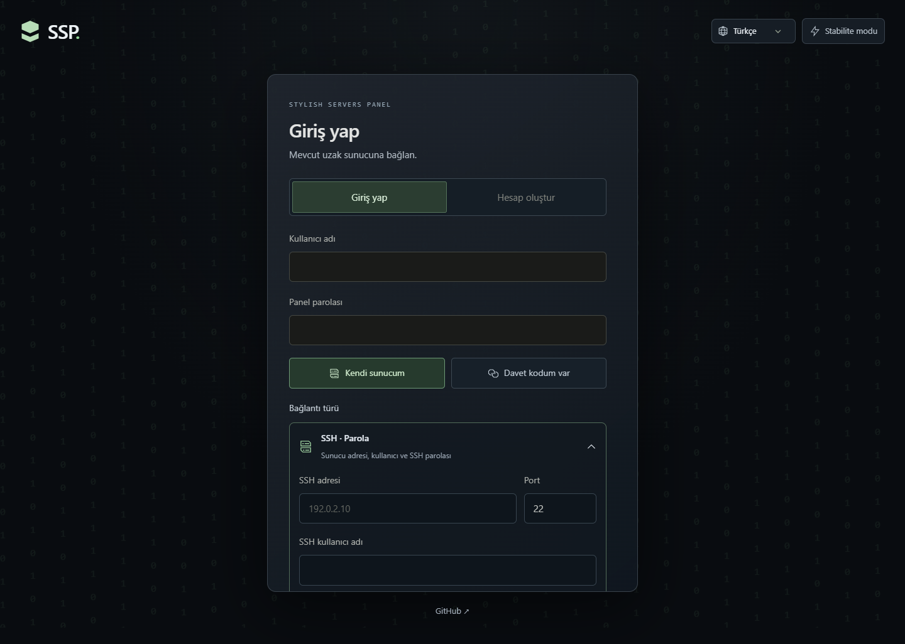

# SSP · Stylish Servers Panel

Mevcut uzak oyun sunucularına bağlanıp oyuncuları, sohbeti, konsolu, modları ve erişimleri yöneten açık kaynak panel. SSP yeni bir oyun sunucusu oluşturmaz. Bağlantıyı doğrular, mevcut kurulumu okur ve doğrudan yönetim alanına geçer.



## Başlangıç

Node.js **24+** ve npm gerekir.

```sh
git clone https://github.com/OpenMTLLC/StylishServersPanel_SSP.git
cd StylishServersPanel_SSP
npm ci
npm run build
npm start
```

Panel: `http://127.0.0.1:3001`.

1. **Hesap oluştur** ile panel kullanıcı adı ve parolasını belirleyin. Kendi sunucusuna bağlanan yeni kullanıcı için davet gerekmez.
2. **Kendi sunucum** altında bağlantı türünü açın: SSH parola, SSH özel anahtar veya HTTPS SSP Bridge. Bağlantı kimlik bilgilerinin doğrulanması zorunludur.
3. SSH kullanıyorsanız sunucu parmak izini alın ve bağımsız kaynaktan doğrulayın. Gerekiyorsa mevcut oyun sunucusunun tam dizinini belirtin. Birden fazla kurulum bulunursa dizini seçin.
4. Mevcut kurulum bir kez taranır; yeni kurulum ekranı açılmadan panel gösterilir. Sonraki girişlerde uzak bağlantı yeniden doğrulanır, tarama tekrar çalıştırılmaz. **Yeniden tara** ile bilgileri güncelleyebilirsiniz.

Başkasının sunucusuna erişmek için **Davet kodum var** seçin ve **Var olan sunucu kodu** alanına size verilen 48 karakterli kodu yazın. Bu mod SSH bilgisi istemez. Kendi sunucum seçiliyken kod alanı gösterilmez.

Geliştirme: ayrı terminallerde `npm run dev` ve `npm run dev:web`. Vite, `http://127.0.0.1:5173` üzerindeki `/api` isteklerini 3001 portuna iletir.

## Yönetim

- Birden fazla mevcut sunucu bağlantısı; SSH parmak izi doğrulaması; şifrelenmiş bağlantı bilgileri.
- Minecraft Paper/Fabric/Forge/NeoForge gibi mevcut kurulumların algılanması. RAM, JVM bellek sınırı, disk, açık/kapalı durum, çevrimiçi ve toplam benzersiz oyuncu, diskteki modlar için tek seferlik salt okunur keşif. Doğrulanamayan bilgi sıfır yerine bilinmiyor olarak kalır.
- Oyuncu adı, ping, UUID kopyalama, toplam oyun süresi, yeşil/gri durum noktaları; arama, filtre, sıralama ve sayfalama. Yetkiye göre yasaklama, rol ve envanter yönetimi.
- Genel sohbet, tek oyuncu, iki kişi arasındaki fısıltılar ve komut filtreleri.
- Oyuna ve moda uygun envanter sağlayıcılarıyla ana envanter, ender sandığı ve ek depolar. Sağlayıcısı olmayan çanta modu otomatik desteklenmez.
- Modrinth ve CurseForge katalogları; oyun sürümü/yükleyici kontrolüyle tek tıkla mod ve zorunlu bağımlılıklarını kurma. Mod listesi kendi alanında kayar. CurseForge resmi API anahtarı gerektirir ve yazarın indirme izinleri korunur.
- İşlemi yapan panel kullanıcısı, zaman, işlem türü ve durumla kayıt. Varsayılan saklama 90 gün; son üç geri alınabilir işlemi en yeniden başlayarak geri alma. Başka bir değişiklik varsa geri alma durur.
- Mat siyah, metalik gri ve kod yeşili arayüz; SSP için çizilmiş SVG simgeleri. Akan ikili kod arka planı, akışı durduran kalıcı stabilite tercihi.
- İlk açılışta tarayıcı/sistem dilinden Türkçe, İngilizce, Almanca veya Fransızca seçimi. Dil tercihi tarayıcıda saklanır; desteklenmeyen dilde İngilizce kullanılır. Sunucu günlükleri ve kullanıcı mesajları özgün dilinde kalır.

## Erişim kodları ve özel ayar

**Ayarlar → Erişim kodları** içinden İzleyici, Operatör, Yönetici veya **Özel ayar** seçilir. Özel ayar, görünür sekmeleri ve her sekmede yapılabilecek işlemleri ayrı belirler. Örneğin oyuncuları görüntüleme ve rol değiştirme verilirken yasaklama veya envanter düzenleme kapalı tutulabilir.

| Profil | Varsayılan kapsam |
| --- | --- |
| İzleyici | Ayarlar dışındaki sekmeleri ve verileri görüntüler |
| Operatör | Görüntüleme, güç işlemleri, SSH taraması, moderasyon, sohbet, envanter, geri alma |
| Yönetici / Sahip | Tüm sekmeler ve işlemler |
| Özel ayar | Yalnızca seçili sekme ve işlemler |

Yetkiler API tarafında uygulanır; yetkisiz veriler anlık görüntüden çıkarılır. Erişim yöneticisi kendi kapsamından fazlasını paylaşamaz. Kod ilk kullanımda bir hesaba bağlanır, yedi gün geçerlidir ve bu süre boyunca aynı hesapla tekrar girişte kullanılabilir. İptal, kodla verilmiş sunucu üyeliğini de hemen kaldırır. Sunucu sahibi rolü kodla verilemez.

## Oyun bağlantısının kapsamı

SSH keşfi mevcut oyun dosyalarını yeniden oluşturmaz ve oyun başlatmaz. Oyun içi oyuncu, sohbet ve envanter ayrıntıları uygun oyun sağlayıcısı gerektirir. Depoda Paper 1.21.4 için Java 21 eklentisi ve Python süreç köprüsü bulunur. Paper eklentisi Fabric/Forge/NeoForge üzerinde çalışmaz; bunlar için uyumlu sağlayıcı gerekir. Valheim, Terraria ve Rust için genel bağlantı/keşif altyapısı vardır; hazır oyun içi köprüler bulunmaz.

Güç ve ham konsol işlemleri için mevcut sunucunun süreç yönetimi köprüye bağlanmalıdır. Başka bir servis tarafından çalıştırılan sunucu için başarı taklidi yapılmaz. Ham komutlar, gönderilmiş sohbet ve mod dosyası işlemleri geri alınamaz; geri alma dünya yedeğinin yerini almaz.

[SSH ve keşif](docs/SSH.md) · [Oyun köprüsü](docs/BRIDGE.md) · [Mod katalogları](docs/MODS.md) · [Doğrulama](docs/TESTING.md)

## Dağıtım ve veri

```sh
docker compose up -d --build
```

Docker derlemesi Paper eklentisini de hazırlar. Eklenti mevcut oyun sunucusuna [köprü belgesine](docs/BRIDGE.md) göre yüklenir. Kalıcı panel verisi `ssp-data` volume'ündedir. Varsayılan dinleme adresi `127.0.0.1:3001`; dış erişimde HTTPS reverse proxy ve `SSP_SECURE_COOKIE=true` kullanın. `.env.example` içindeki değişkenleri süreç ortamında sağlayın; `.env` kendiliğinden okunmaz.

SQLite, oturumlar ve anahtar `data/` içindedir ve Git'e dahil edilmez. Parolalar scrypt, uzak erişim bilgileri AES-256-GCM ile korunur. Oturum ve erişim kodları özet olarak saklanır. `data/ssp.sqlite` ile `data/master.key` birlikte yedeklenmelidir. Ayrıntılar [SECURITY.md](SECURITY.md) içindedir.

## Kontroller

```sh
npm test
python -m unittest discover -s tests -p '*_test.py' -v
npm run build
npm audit
mvn -B -f bridge/paper/pom.xml package
```

GitHub Actions panel kontrollerini ve Paper eklenti derlemesini çalıştırır. Canlı uzak sunucu sağlanmadan gerçek oyun dünyasında uçtan uca davranış doğrulanamaz.

[Katkı rehberi](CONTRIBUTING.md) · [MIT lisansı](LICENSE)
