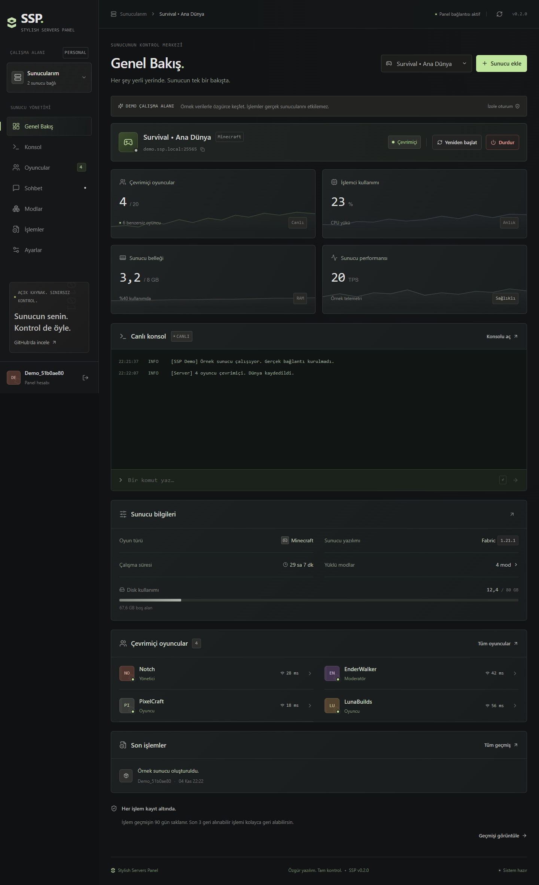

# SSP · Stylish Servers Panel

Açık kaynak, Türkçe oyun sunucusu yönetim paneli. Pterodactyl benzeri yönetim mantığını oyuncu, sohbet ve geri alınabilir işlem araçlarıyla birleştirir. Mat siyah, metal gri ve düşük kontrastlı ikili sayı deseni kullanır.



## Hızlı başlangıç

Node.js **24+** ve npm gerekir.

```sh
git clone https://github.com/OpenMTLLC/StylishServersPanel_SSP.git
cd StylishServersPanel_SSP
npm ci
npm run build
npm start
```

Panel: `http://127.0.0.1:3001`. İlk açılışta yönetici kullanıcı adını ve parolasını oluşturun veya **Demoyu keşfet** ile ayrı örnek ortamı açın. Demo gerçek bir sunucuya bağlanmaz.

Geliştirmede API için `npm run dev`, ayrı terminalde arayüz için `npm run dev:web` çalıştırın. Vite `http://127.0.0.1:5173` adresinde `/api` isteklerini 3001 portuna yönlendirir.

## Özellikler

- Birden fazla sunucu, SSH parola/anahtar bağlantısı, SHA256 sunucu parmak izi doğrulaması.
- Kullanıcı hesabı, sunucuya göre viewer/operator/admin yetkileri, 48 karakterli tek kullanımlık davet kodu.
- Oyuncu adı, ping, UUID, toplam oynama süresi, yeşil/gri çevrimiçi göstergesi; yasaklama ve yetki yönetimi.
- Genel sohbet, oyuncuya göre filtre, iki kişi arasındaki fısıltılar ve komut kayıtları.
- Ana envanter ve oyuna/moda özel envanter sağlayıcıları. Desteklenen sağlayıcının verisi görüntülenip düzenlenir.
- Modrinth ve CurseForge kataloglarında sürüm/yükleyici filtresi; tek tıkla mod ve zorunlu bağımlılıklarını kurma. CurseForge için resmi API anahtarı gerekir; yazarın indirme kısıtları korunur.
- İşlemi yapan panel kullanıcısıyla birlikte kayıt; varsayılan 90 gün saklama; kullanıcının son üç geri alınabilir işlemini en sondan başlayarak geri alma.
- Minecraft Paper/Fabric/NeoForge/Vanilla için otomatik kurulum planı ve SSH üzerinden kurulum, manuel kurulum yönlendirmesi ve işlem günlükleri.

## Hazır kurulu sunucuyu bağlama

Sunucu eklerken önce **Hazır kurulu sunucum var** seçin. SSH bağlantısını ve bağımsız olarak doğrulanmış SHA256 parmak izini girdikten sonra tek seferlik salt okunur tarama çalışır. Sunucu ana dizinin dışında bulunuyorsa mutlak oyun dizinini yazın; birden fazla kurulum varsa doğru dizini seçin.

Tarama fiziksel RAM'i, ayrılmış JVM RAM'ini, disk kullanımını, açık/kapalı durumunu, çevrimiçi oyuncu sayısını, bilinen toplam oyuncu sayısını ve diskteki JAR modlarını ayrı alanlarda gösterir. İzinler veya Minecraft durum sorgusu yüzünden okunamayan bilgi **bilinmiyor** olarak kalır. Oyuncu toplamı dünya geçmişinden, bu yoksa etiketlenmiş önbellek kaynağından hesaplanır. Anlık yüklü modlar ile diskteki mod listesi aynı şey değildir.

Mevcut sunucu doğrudan panele eklenir; yeni oyun sürümü, kurulum yöntemi veya EULA kurulum ekranı açılmaz ve hiçbir oyun dosyası yeniden kurulmaz. Sonraki değişiklikler için SSH taramasını panelden yenileyebilirsiniz. Oyuncu sohbeti/canlı envanter gibi ayrıntılar yine oyuna uygun sağlayıcı gerektirir.

[Mod sağlayıcıları ve tek tıkla kurulum](docs/MODS.md) · [SSH ve keşif ayrıntıları](docs/SSH.md)

## Gerçek sunucu bağlantısı ve kapsam

SSH, işletim sistemi bağlantısı ve kurulum içindir. Oyuncu pingleri, sohbet ve canlı envanter gibi oyun içi veriler ayrıca oyun köprüsü gerektirir. Bu depoda Paper için gerçek bir Java eklentisi ve genişletilebilir envanter sağlayıcı sözleşmesi bulunur; [köprü kurulumu](docs/BRIDGE.md) ve [SSH kurulumu](docs/SSH.md) belgelerine bakın.

Fabric/Forge/NeoForge çanta modlarının kendi NBT/bileşen yapıları vardır. Her çanta modu otomatik olarak desteklenmez; modun bir envanter sağlayıcısına bağlanması gerekir. Sağlayıcı yoksa panel desteklenmeyen işlemi hata olarak gösterir. Paper eklentisi Fabric/Forge/NeoForge üzerinde çalışmaz. Valheim, Terraria ve Rust için seçim/manuel plan akışı bulunur; bu sürümde hazır canlı oyun köprüleri yoktur.

Geri alma, kaydedilmiş ters işlemi bulunan işlemler içindir. Ham konsol komutu, gönderilmiş sohbet mesajı veya otomatik kurulum geri alınamaz. Dünya/veri yedeğinin yerini almaz. İşlem geçmişi saklama ayarı panel kayıtlarını yönetir; Minecraft'ın kendi log dosyalarını silmez.

## Docker

```sh
docker compose up -d --build
```

Docker derlemesi Paper köprüsü JAR dosyasını da hazırlar. Yerel npm kurulumunda oyuncu/sohbet/envanter köprüsü için ayrıca Maven komutunu çalıştırın veya GitHub Actions çıktısından JAR dosyasını alın. Otomatik kurulum SSH üzerinden süreç köprüsünü aktarır; oyun dünyası panelde Başlat seçilince açılır. Kalıcı veri `ssp-data` volume'ünde tutulur. Varsayılan port yalnızca `127.0.0.1:3001` adresine bağlıdır. Dış erişim için HTTPS reverse proxy ekleyip `SSP_SECURE_COOKIE=true` ayarlayın.

Ortam değişkenleri `.env.example` dosyasında gösterilir. Değişkenleri işletim sistemi, Docker veya süreç yöneticisi üzerinden sağlayın; `.env` dosyası otomatik okunmaz.

Viewer yalnızca görüntüler. Operator güç işlemlerini, sohbeti, oyuncu moderasyonunu ve envanteri yönetir. Admin/owner ayrıca konsolu, modları, yetkileri, davetleri ve ayarları yönetir. Kullanıcının kendi sunucusundaki erişimi diğer sunuculara aktarılmaz.

## Veri ve güvenlik

SQLite veritabanı, oturumlar ve anahtar `data/` altında saklanır; bu klasör Git'e dahil edilmez. Parolalar scrypt ile özetlenir; SSH bilgileri, köprü tokenları ve panelden girilen CurseForge anahtarları AES-256-GCM ile şifrelenir. Davet ve oturum tokenları veritabanında özet olarak tutulur. Yetki ve CSRF kontrolleri API'de uygulanır.

`data/ssp.sqlite` ve `data/master.key` birlikte yedeklenmelidir. Anahtar kaybolursa kayıtlı SSH bilgileri çözülemez. Ayrıntılar: [SECURITY.md](SECURITY.md).

## Doğrulama ve katkı

```sh
npm test
python -m unittest discover -s tests -p '*_test.py' -v
npm run build
npm audit
mvn -B -f bridge/paper/pom.xml package
```

GitHub Actions panel testlerini, TypeScript/üretim derlemesini ve Paper köprüsü derlemesini çalıştırır. Canlı bir uzak sunucu sağlanmadan gerçek SSH kurulumu ve oyun davranışı uçtan uca doğrulanamaz.

[Katkı rehberi](CONTRIBUTING.md) · [MIT lisansı](LICENSE)


